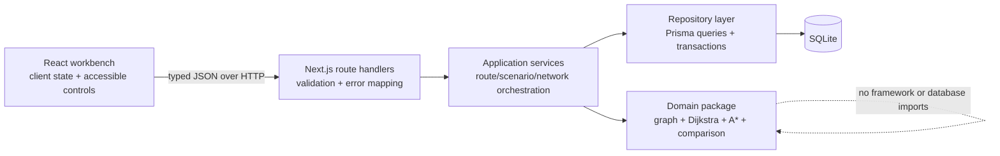
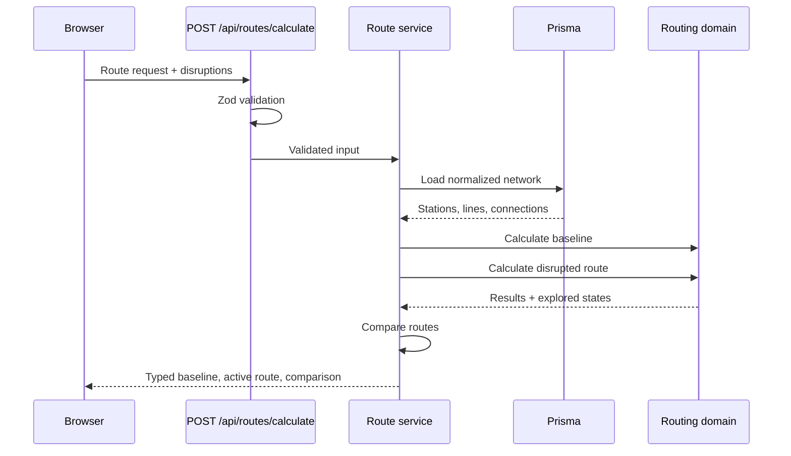
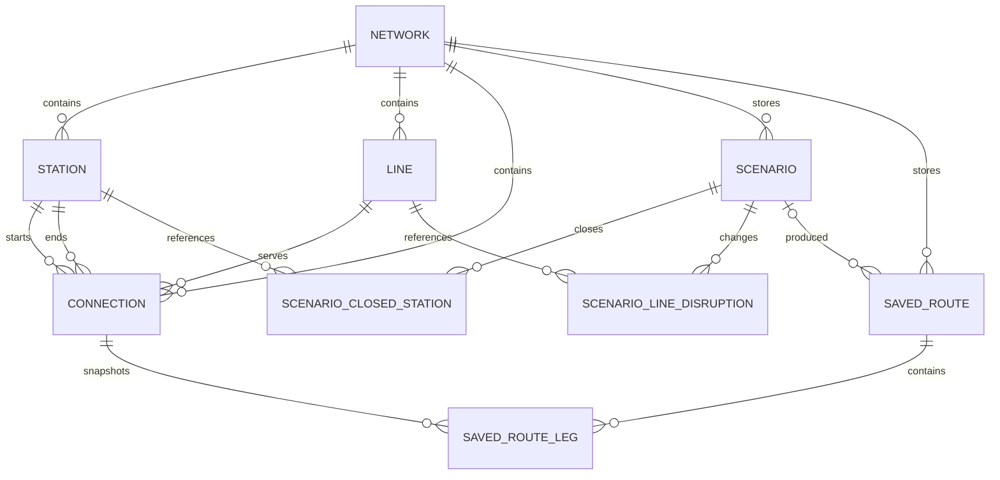

# TransitLab

**Plan the route. Disrupt the network. Watch the graph adapt.**

TransitLab is a full-stack public-transit route planner and disruption simulator. It models a fictional transit system as a weighted graph, calculates routes on the server with Dijkstra or A\*, and makes the consequences of station closures, line suspensions, delays, accessibility constraints, and transfer penalties visible in an interactive SVG network.

The project is intentionally more than a pathfinding demo: networks, scenarios, disruptions, and saved route snapshots are validated at an HTTP boundary and persisted in SQLite through Prisma. The bundled Alder City network works without API keys, accounts, or external map services.

## Screenshots


The screenshot above is captured from the verified local production build with Central Exchange closed. To refresh it, initialize the database, run `npm run dev`, open `http://localhost:3000`, calculate a route, and capture the full page at desktop width. To add a mobile screenshot, repeat at approximately 500 px wide and save it as `docs/transitlab-mobile.png`.

## What it does

- Calculates deterministic shortest routes with Dijkstra or A\*.
- Optimizes for fastest journey, fewest transfers, or wheelchair accessibility.
- Applies transfer penalties, line delays, closures, suspensions, and accessibility filters inside the routing engine.
- Compares an undisrupted baseline against the active simulation, including time, stop, transfer, and path changes.
- Renders stations, lines, transfers, closures, and the selected route in a local responsive SVG map.
- Explains the objective, active constraints, heuristic, and number of explored graph states.
- Imports and exports a versioned JSON network format with structural and referential validation.
- Persists scenarios and recalculated route snapshots through typed backend APIs and SQLite.
- Filters and paginates saved scenarios, and restores the deterministic built-in network.
- Handles malformed requests, unreachable routes, inaccessible endpoints, cycles, identical endpoints in the domain layer, and database-integrity failures.

## Architecture

The presentation layer never imports Prisma or the router. Client actions call Next.js route handlers; handlers validate with Zod and delegate to application services; services coordinate repository queries and framework-independent domain logic.



### Request flow



### Package boundaries

- `src/components` — browser presentation and transient planner state.
- `src/lib` and `src/shared` — API client, response DTOs, and shared Zod contracts.
- `src/app/api` — HTTP route handlers and status codes.
- `src/server/services` — application use cases and transactions.
- `src/server/repositories` — Prisma data access and domain mapping.
- `src/domain` — graph construction, priority queue, routing, and comparison; no Next.js or Prisma imports.
- `prisma` — normalized schema, versioned migration, deterministic seed, and example network data.

## Graph and routing model

### Data model

A `Station` is a vertex with display coordinates and an accessibility flag. A `Connection` is a persisted edge that names a transit line, travel time, directionality, and accessibility. Graph construction expands each bidirectional connection into two directed edges and sorts adjacency lists, which is part of the stable tie-breaking strategy.

Search state is `(stationId, currentLineId)`, not just a station. Carrying the current line lets the engine charge a transfer penalty only when a traveler changes lines. It also prevents a superficially shortest station path from hiding a more expensive transfer sequence.

The active edge cost is:

```text
travel time + transfer penalty when changing lines + delay when boarding a delayed line
```

For `FASTEST` and `ACCESSIBLE`, routes are ordered lexicographically by total minutes, transfers, then stops. `FEWEST_TRANSFERS` orders by transfers, total minutes, then stops. Equal costs use the directed-edge signature and state key for deterministic results.

Station closures remove incident edges, suspended lines remove all edges on that line, and accessible routing rejects any inaccessible station or connection. These rules run during neighbor expansion, so disruptions are part of the search rather than UI decoration.

### Dijkstra

Dijkstra assigns a zero heuristic and repeatedly finalizes the reachable state with the lowest known cost. With a binary heap and adjacency lists, its typical complexity is `O((V + E) log V)` and space is `O(V + E)`. Here, `V` refers to reachable `(station, current line)` states, which can be larger than the station count.

### A\* and its admissible heuristic

A\* prioritizes `known cost + estimated remaining minutes`. TransitLab computes:

```text
straight-line distance to destination / fastest geometric network speed
```

The fastest geometric speed is the maximum coordinate-distance-per-minute observed among currently usable edges. By construction, every usable edge needs at least its geometric distance divided by that maximum speed. The heuristic also ignores transfer penalties, line delays, and network detours—all non-negative costs—so it cannot overestimate the true remaining cost. It is therefore admissible. When the heuristic provides little information, A\* safely behaves more like Dijkstra.

### Tradeoffs

- The geometry is schematic rather than geographic, so the heuristic is valid for the model but not a prediction of real-world vehicle speed.
- Delay is charged when boarding a line, including after a transfer, rather than on every segment. That models service-entry delay without multiplying one incident across a line.
- Multi-criteria preferences use deterministic lexicographic ordering instead of exposing arbitrary scaling constants.
- The implementation favors an inspectable binary heap and explicit state maps over a graph library so the core algorithms remain interviewable.

## Database

SQLite keeps local setup small while still demonstrating migrations, foreign keys, constraints, indexes, transactions, and a real persistence boundary. Prisma supplies typed queries; the checked-in SQL migration adds database-level checks for positive travel times and bounded disruption values.



Important constraints include per-network unique station and line codes, a unique connection per `(network, from, to, line)`, compound foreign keys that keep referenced entities in the same network, cascade deletion for owned records, and restrictive deletion for history referenced by a saved route.

## API contract

All bodies are JSON and validated at the server boundary. Success responses use `{ "data": ... }`; list responses also include `{ "meta": { page, pageSize, total, totalPages } }`. Errors consistently use:

```json
{
  "error": {
    "code": "VALIDATION_ERROR",
    "message": "The request did not pass validation.",
    "details": [
      { "path": "disruptions.lineDelays.line-id", "message": "Too small" }
    ]
  }
}
```

| Method             | Endpoint                                                   | Purpose                                                             |
| ------------------ | ---------------------------------------------------------- | ------------------------------------------------------------------- |
| `GET`              | `/api/health`                                              | Check the application and database connection.                      |
| `GET`              | `/api/networks`                                            | List network summaries.                                             |
| `GET`              | `/api/networks/:networkId`                                 | Load a complete normalized network.                                 |
| `POST`             | `/api/networks/import`                                     | Validate and transactionally import network JSON.                   |
| `GET`              | `/api/networks/:networkId/export`                          | Export the public versioned JSON format.                            |
| `POST`             | `/api/routes/calculate`                                    | Calculate baseline and active routes on the server.                 |
| `GET`              | `/api/scenarios?networkId=...&query=...&page=1&pageSize=8` | Filter and paginate scenarios.                                      |
| `POST`             | `/api/scenarios`                                           | Persist a scenario and its disruptions.                             |
| `GET/PATCH/DELETE` | `/api/scenarios/:scenarioId`                               | Read, update, or delete one scenario.                               |
| `GET`              | `/api/saved-routes?networkId=...&page=1&pageSize=8`        | Paginate saved route snapshots.                                     |
| `POST`             | `/api/saved-routes`                                        | Recalculate server-side and persist a route with ordered legs.      |
| `GET/DELETE`       | `/api/saved-routes/:routeId`                               | Read or delete a saved route.                                       |
| `POST`             | `/api/reset`                                               | Restore only the built-in network and remove its dependent records. |

Pagination defaults to 8 items and is capped at 50. Validation failures return `422`, malformed JSON returns `400`, conflicts return `409`, missing records return `404`, and unexpected details are not exposed to clients.

## Network import format

Imports must use `schemaVersion: 1`. Codes accept letters, numbers, underscores, and hyphens; slugs are lowercase kebab case; line colors are six-digit hex values. Coordinates are schematic SVG positions. Validation rejects duplicate or unknown references, self-loops, duplicate connections, invalid times, and extra object keys before a transaction writes anything.

```json
{
  "schemaVersion": 1,
  "network": {
    "name": "Example Metro",
    "slug": "example-metro",
    "description": "A minimal import example.",
    "transferPenaltyMinutes": 4
  },
  "lines": [{ "code": "R", "name": "Red Line", "color": "#d1495b" }],
  "stations": [
    { "code": "ALP", "name": "Alpha", "x": 80, "y": 120, "accessible": true },
    { "code": "BET", "name": "Beta", "x": 240, "y": 120, "accessible": true }
  ],
  "connections": [
    {
      "from": "ALP",
      "to": "BET",
      "line": "R",
      "travelMinutes": 5,
      "bidirectional": true,
      "accessible": true
    }
  ]
}
```

The full deterministic example is in `prisma/seed-data/alder-city.json`.

## Local setup

Requirements: Node.js 24 or newer and npm 10 or newer. No external service is needed.

```bash
cd transitlab
npm install
npm run db:init
npm run dev
```

Open `http://localhost:3000`. `db:init` creates `prisma/dev.db` if needed, applies every versioned migration, and seeds Alder City deterministically.

`DATABASE_URL` selects the SQLite file. `APP_URL` supplies the absolute base for generated Open Graph metadata; the checked-in `.env.example` contains local defaults for both.

To run the production build:

```bash
npm run build
npm run start
```

### Commands

| Command                           | Action                                                             |
| --------------------------------- | ------------------------------------------------------------------ |
| `npm run db:init`                 | Create the SQLite file, deploy migrations, and seed built-in data. |
| `npm run db:migrate`              | Create/apply a development migration after changing the schema.    |
| `npm run db:seed`                 | Restore deterministic built-in seed records.                       |
| `npm run dev`                     | Start the development server.                                      |
| `npm run build` / `npm run start` | Build and run the production server.                               |
| `npm run format:check`            | Verify Prettier formatting.                                        |
| `npm run lint`                    | Run ESLint with zero warnings allowed.                             |
| `npm run typecheck`               | Run strict TypeScript checking without emission.                   |
| `npm run test`                    | Rebuild an isolated migrated `prisma/test.db` and run all tests.   |
| `npm run quality`                 | Run formatting, lint, types, tests, and production build.          |

## Testing strategy

`src/domain/router.test.ts` exercises graph construction, dangling-reference rejection, Dijkstra/A\* parity, stable tie-breaking, preferences, transfer penalties, closures, delays, line suspensions, accessibility, cycles, identical endpoints, comparison, and unreachable routes.

`src/server/api.integration.test.ts` invokes real route handlers against an isolated SQLite file. It verifies route calculation through the HTTP boundary, malformed and invalid input, persisted scenario relationships, filtering/pagination, server-recalculated saved routes, deterministic reset behavior, foreign keys, and migration-level checks. The test-preparation script deletes only `prisma/test.db`, recreates it, deploys the checked-in migrations, and seeds it before Vitest starts.

```bash
npm run test
npm run quality
```

GitHub Actions runs the same checks on Node.js 24 for pushes and pull requests.

## Project structure

```text
transitlab/
├── .github/workflows/ci.yml
├── prisma/
│   ├── migrations/                  # Versioned SQLite schema
│   ├── seed-data/alder-city.json    # Public example network
│   ├── schema.prisma
│   └── seed.ts
├── prisma.config.ts                 # Prisma CLI paths and seed command
├── scripts/
│   ├── ensure-database.ts
│   └── prepare-test-database.ts
├── src/
│   ├── app/api/                     # Next.js HTTP boundary
│   ├── components/                  # Workbench and SVG network
│   ├── domain/                      # Graph and routing algorithms
│   ├── lib/                         # Browser API client
│   ├── server/                      # Services, repositories, Prisma
│   └── shared/                      # Zod contracts and API DTOs
├── CONTRIBUTING.md
├── LICENSE
└── README.md
```

## Engineering decisions

- **Next.js route handlers instead of a separate API process:** one deployable TypeScript application, while explicit layers preserve testable boundaries.
- **SQLite + Prisma:** credible relational persistence and migrations with a one-command local setup; appropriate for a portfolio-scale single-node application.
- **No map provider or graph library:** the project is offline-ready, the SVG is fully controllable, and the algorithms remain visible in source.
- **Baseline and simulation in one response:** both routes use the same persisted network snapshot and domain engine, making comparison consistent.
- **Transactions for aggregate writes:** network import, scenario replacement, seed/reset, and route-leg persistence cannot leave partial aggregates.
- **Backend-owned persistence:** the browser stores only transient component state; all durable product data goes through APIs.

## Known limitations

- SQLite and the local filesystem suit a single application instance, not horizontally scaled serverless deployment.
- The network is schematic and does not model timetables, vehicle capacity, walking entrances, real-time arrivals, or geographic projections.
- Delay is deterministic and line-wide; it does not represent distributions or segment-specific incidents.
- Authentication and per-user ownership are intentionally out of scope, so a local instance has one shared scenario library.
- A\* is optimized for fastest-time routing. For the lexicographic fewest-transfer preference, its time estimate remains safe but may offer limited pruning.

## Future improvements

- Add GTFS static-feed ingestion and coordinate projection while retaining the versioned internal schema.
- Model departure times with time-dependent edges and RAPTOR or Connection Scan Algorithm comparisons.
- Add user accounts and authorization before multi-user hosting.
- Stream algorithm exploration to an educational step-through visualization.
- Benchmark larger generated networks and expose reproducible performance traces.
- Move to PostgreSQL for concurrent production deployment and add OpenTelemetry request tracing.

## What I learned — personalize these prompts

Do not copy these verbatim into a reflection; replace each prompt with your own experience:

- What assumption about graph state changed when you added transfer penalties?
- Which failing test revealed the most important modeling or persistence mistake?
- How would you explain the admissibility proof in your own words?
- What tradeoff did you make between product scope and algorithm depth?
- What did the API integration tests catch that domain unit tests could not?

## Resume bullet options

- Built a full-stack transit disruption simulator with Next.js, TypeScript, Prisma, and SQLite, separating an accessible React workbench from validated APIs and framework-independent graph logic.
- Implemented deterministic Dijkstra and A\* routing with an admissible geometric heuristic, transfer-aware state, accessibility constraints, line delays, closures, and baseline-versus-disruption comparison.
- Designed a normalized relational model, versioned migrations, transactional JSON import/reset flows, and isolated SQLite integration tests covering API validation, persistence, routing, and database integrity.

## Interview questions to prepare for

1. Why does the search state include the current line as well as the station?
2. How can you prove the A\* heuristic does not overestimate remaining travel time?
3. When might A\* explore as many states as Dijkstra in this network?
4. How does lexicographic optimization differ from combining objectives into one weighted score?
5. Where are closures, delays, transfer penalties, and accessibility applied in the algorithm?
6. How do stable tie-breakers make behavior and tests deterministic?
7. Which invariants are protected by Zod, which by domain checks, and which by the database?
8. Why use an isolated migrated SQLite database for API integration tests?
9. What consistency problems do the transactions prevent during import, reset, or scenario updates?
10. What would have to change to support schedules, real GTFS data, concurrent users, or multiple server instances?

## License

MIT — see [LICENSE](LICENSE).
