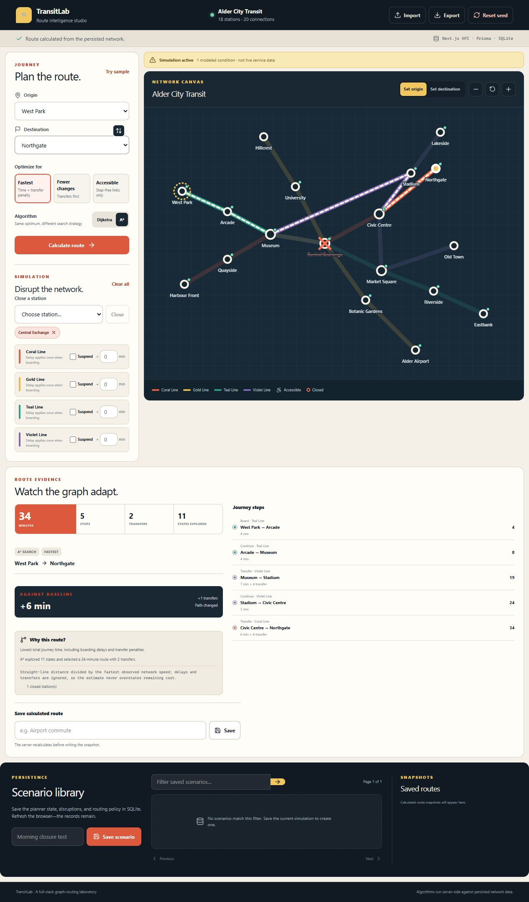
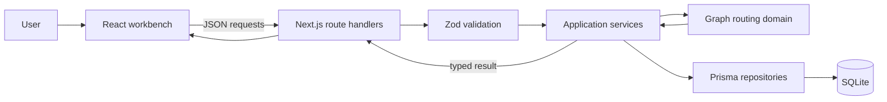
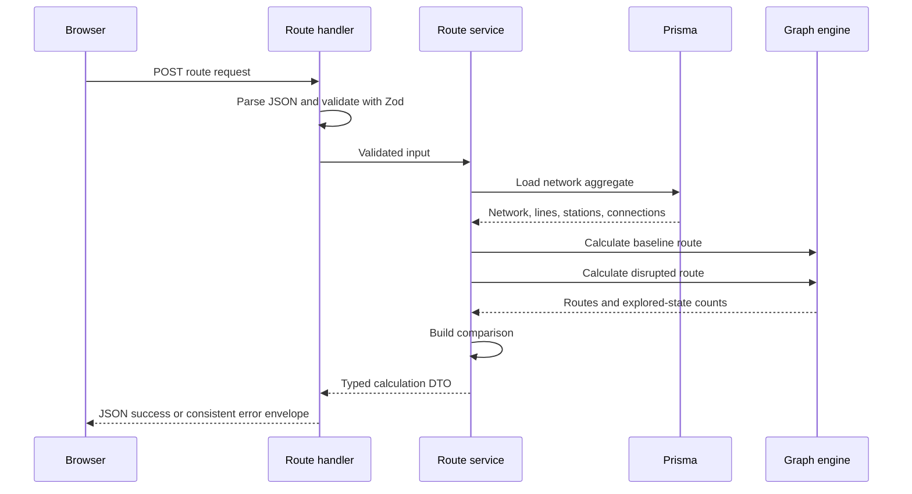
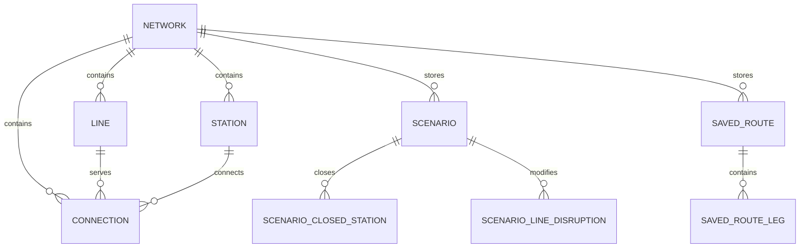

# TransitLab Project Report

**Project:** TransitLab  
**Repository:** [ryanbudwal/TransitLab](https://github.com/ryanbudwal/TransitLab)  
**Report date:** August 31, 2026  
**Status:** Complete, tested, and running through GitHub Actions

## Executive summary

TransitLab is a full-stack public-transit route planner and disruption simulator. A user selects an origin, destination, routing preference, and shortest-path algorithm, then observes the calculated journey on an interactive transit diagram. The user can close stations, suspend lines, add boarding delays, or require an accessible route and see the graph engine recalculate around those constraints.

The project demonstrates more than a visual pathfinding example. Route calculations happen on the backend against network data loaded from SQLite. Inputs are validated at the API boundary, saved scenarios and route snapshots are persisted relationally, and database migrations enforce integrity. The central algorithms are implemented without a graph library so their data structures, cost model, heuristic, and deterministic behavior can be explained directly.

TransitLab is self-contained. It uses a fictional network called Alder City Transit, renders its own SVG map, and requires no map provider, API key, account, paid service, or live-transit feed.

## What problem it solves

Finding a transit route is not simply finding the fewest edges between two stations. A useful route planner must account for several interacting conditions:

- Connections have different travel times.
- Changing lines can make a route less desirable even when the physical path is short.
- A delay should affect the real path cost.
- Closed stations and suspended lines should make affected edges unavailable.
- An accessible journey must exclude inaccessible stations and links.
- Two routes with equal primary cost should still produce a stable result.

TransitLab turns these concerns into one inspectable weighted-graph model. Its interface then shows both the selected route and evidence for why the algorithm chose it.

## Product experience

The main workbench is organized around three questions:

1. **Where are you travelling?** The journey controls select origin, destination, routing preference, algorithm, and transfer penalty.
2. **What changed in the network?** Simulation controls close stations, suspend entire lines, or add line-specific boarding delays.
3. **Why did the route change?** The evidence panel shows journey steps, total minutes, stops, transfers, lines used, states explored, and a baseline comparison.

A typical workflow is:

1. Load the built-in Alder City network from the backend.
2. Calculate the default West Park to Northgate journey.
3. Close Central Exchange, which invalidates the original path.
4. Recalculate through the API.
5. Observe the new route through Stadium, the added time, the changed transfer count, and the lower-level explanation.
6. Save the complete disruption scenario or the calculated route snapshot to SQLite.
7. Reload the page later and retrieve the saved data through the backend API.



## System architecture

TransitLab uses one TypeScript codebase while preserving explicit architectural boundaries.



### Layer responsibilities

| Layer                | Responsibility                                                                                  | Key location              |
| -------------------- | ----------------------------------------------------------------------------------------------- | ------------------------- |
| Presentation         | Accessible controls, transient planner state, SVG network rendering, loading/error/empty states | `src/components`          |
| Shared contracts     | Zod request schemas, API response shapes, shared TypeScript types                               | `src/shared`              |
| HTTP boundary        | Parse requests, select status codes, return consistent error envelopes                          | `src/app/api`             |
| Application services | Coordinate use cases, transactions, routing, comparison, and persistence                        | `src/server/services`     |
| Repository           | Load and map normalized Prisma records                                                          | `src/server/repositories` |
| Domain               | Graph construction, priority queue, Dijkstra, A\*, route comparison                             | `src/domain`              |
| Persistence          | Prisma schema, SQLite migration, deterministic seed                                             | `prisma`                  |

The domain package does not import React, Next.js, Prisma, or browser APIs. This makes the routing engine independently testable and keeps framework concerns out of algorithmic code.

## Technology stack

| Technology                      | Role                                                                 |
| ------------------------------- | -------------------------------------------------------------------- |
| TypeScript                      | Shared language across browser, API, domain, scripts, and seed logic |
| Next.js 16                      | React frontend, production build, and server-side route handlers     |
| React 19                        | Interactive workbench and client state                               |
| Tailwind CSS 4 plus project CSS | Styling foundation and responsive visual system                      |
| Prisma 6                        | Typed relational queries, transactions, migrations, and seeding      |
| SQLite                          | Local relational persistence with no external server requirement     |
| Zod 4                           | Runtime validation of request bodies and imported networks           |
| Vitest 4                        | Domain unit tests and API/persistence integration tests              |
| GitHub Actions                  | Automated formatting, linting, type checking, testing, and building  |

## Graph model

### Vertices and edges

Each station is a graph vertex. A persisted connection describes an edge with:

- its origin and destination stations;
- its transit line;
- a positive travel time;
- whether travel is bidirectional;
- whether the connection is wheelchair accessible.

During graph construction, a bidirectional database connection becomes two directed in-memory edges. Adjacency lists make neighbor lookup efficient and are sorted to help guarantee stable results.

### Why the search state includes the current line

The routing state is not only a station ID. It is:

```text
(stationId, currentLineId)
```

This distinction is essential. Arriving at the same station on two different lines can produce different future costs because only one arrival may require a transfer on the next edge. If the algorithm stored one cost per station, it could discard a state that becomes better later because it avoids a line change.

### Cost model

For each expanded edge, the fastest-route cost is:

```text
edge travel minutes
+ transfer penalty when currentLineId changes
+ line delay when boarding a new line
```

Line delay is charged once when boarding rather than once per segment. This models a service-entry delay without multiplying the same disruption across every stop on the line.

## Routing preferences

TransitLab supports three real routing policies:

### Fastest journey

Results are ordered by:

1. total minutes;
2. transfers;
3. stops.

Travel time includes the edge time, transfer penalties, and active boarding delays.

### Fewest transfers

Results are ordered by:

1. transfers;
2. total minutes;
3. stops.

This is a lexicographic objective. It avoids arbitrary scaling, such as pretending one transfer is always worth exactly a fixed number of travel minutes.

### Wheelchair-accessible route

The objective remains the fastest valid journey, but neighbor expansion rejects:

- inaccessible origin or destination stations;
- inaccessible intermediate stations;
- inaccessible connections.

Accessibility is therefore part of path feasibility, not a label applied after calculation.

## Dijkstra’s algorithm

Dijkstra’s algorithm uses a binary min-heap to repeatedly finalize the unvisited state with the lowest known cost. It assigns a heuristic of zero, so ordering depends entirely on the cost already accumulated from the origin.

With an adjacency-list graph and binary heap, its typical time complexity is:

```text
O((V + E) log V)
```

Its space complexity is:

```text
O(V + E)
```

In TransitLab, `V` represents reachable `(station, line)` states rather than only physical stations.

Dijkstra is valuable as both a routing option and a correctness reference for A\*: when both are given the same non-negative cost model, they should find the same optimum.

## A\* search

A\* changes queue priority from only the known cost `g(n)` to:

```text
f(n) = g(n) + h(n)
```

TransitLab’s heuristic is:

```text
straight-line distance to the destination
------------------------------------------------
fastest geometric speed on any currently usable edge
```

### Why the heuristic is admissible

The denominator is the greatest coordinate-distance-per-minute speed among usable edges. Therefore, no usable edge can cover geometric distance faster than that value. Straight-line distance is also no greater than the distance of a network path connecting the same points.

The estimate deliberately ignores additional non-negative costs:

- transfer penalties;
- line delays;
- indirect network geometry.

Ignoring those costs can make the estimate too low, but never too high. Consequently, the heuristic does not overestimate the actual remaining cost and is admissible. A\* can prioritize promising states without sacrificing optimality.

## Determinism and tie-breaking

Deterministic output matters for user trust and reliable automated tests. TransitLab resolves equal costs using:

1. the active preference’s lexicographic cost tuple;
2. the directed-edge path signature;
3. the state key;
4. insertion order as a final stable fallback.

The same network and request therefore produce the same route rather than depending on map iteration order or heap implementation details.

## Disruption behavior

Disruptions alter the search itself:

| Disruption                | Routing effect                                        |
| ------------------------- | ----------------------------------------------------- |
| Closed station            | Every incident edge becomes unavailable               |
| Suspended line            | Every edge belonging to the line becomes unavailable  |
| Line delay                | A non-negative cost is added when the line is boarded |
| Accessibility requirement | Inaccessible vertices and edges become unavailable    |

For a disrupted request, the backend calculates two routes against the same persisted network:

- **Baseline:** no simulated disruptions.
- **Active:** the requested closures, suspensions, delays, and accessibility policy.

It then compares total time, stop count, transfer count, and station sequence. The UI can state whether the path changed instead of merely showing a second result.

## Edge cases

The domain and API layers explicitly handle:

- identical origin and destination;
- unknown station or line identifiers;
- closed origins or destinations;
- inaccessible endpoints;
- networks containing cycles;
- unreachable destinations;
- malformed JSON;
- duplicate import codes and connections;
- unknown import references;
- self-loop imports;
- negative or excessive delay values;
- invalid transfer penalties.

An identical origin and destination is valid in the domain and produces a zero-length route. The public route API rejects it as an invalid planning request, demonstrating that domain capabilities and application rules can differ cleanly.

## Backend request flow



All calculation requests pass through this flow. The browser does not contain a separate simplified routing implementation.

## API surface

| Method             | Route                             | Responsibility                                   |
| ------------------ | --------------------------------- | ------------------------------------------------ |
| `GET`              | `/api/health`                     | Verify application and database health           |
| `GET`              | `/api/networks`                   | List available networks                          |
| `GET`              | `/api/networks/:networkId`        | Retrieve a complete network                      |
| `POST`             | `/api/networks/import`            | Validate and transactionally import network JSON |
| `GET`              | `/api/networks/:networkId/export` | Export the public versioned network format       |
| `POST`             | `/api/routes/calculate`           | Calculate baseline and disrupted routes          |
| `GET/POST`         | `/api/scenarios`                  | Filter, paginate, and create scenarios           |
| `GET/PATCH/DELETE` | `/api/scenarios/:scenarioId`      | Manage one scenario                              |
| `GET/POST`         | `/api/saved-routes`               | Paginate and create recalculated route snapshots |
| `GET/DELETE`       | `/api/saved-routes/:routeId`      | Retrieve or remove a snapshot                    |
| `POST`             | `/api/reset`                      | Restore the deterministic built-in network       |

Successful responses use a consistent `data` property. Paginated endpoints also return `page`, `pageSize`, `total`, and `totalPages`. Errors return a stable code and friendly message, with field-level validation details when appropriate.

## Persistence design

The SQLite database is normalized around these aggregates:

- `Network` owns stations, lines, connections, scenarios, and saved routes.
- `Station`, `Line`, and `Connection` describe the transit graph.
- `Scenario` stores the selected journey, routing policy, closed stations, and line disruptions.
- `SavedRoute` stores a server-recalculated result and ordered `SavedRouteLeg` records.



Important database protections include:

- primary and foreign keys;
- same-network compound relationships;
- unique network slugs;
- unique station and line codes within a network;
- unique connection tuples;
- indexes for graph loading, filtering, and pagination;
- positive travel-time checks;
- bounded non-negative disruption values;
- cascading deletion for owned aggregates;
- restrictive deletion where saved history must remain valid.

Network import, seed/reset, scenario replacement, and route snapshot writes use transactions so a failure cannot leave a partially written aggregate.

## Built-in Alder City network

The deterministic seed contains:

- 18 stations;
- 4 transit lines;
- 20 persisted connections;
- accessible and inaccessible stations;
- transfer hubs;
- cycles and alternate paths;
- a topology that can reroute around Central Exchange.

The data lives in `prisma/seed-data/alder-city.json`, using the same documented public format accepted by the import API.

## Frontend and visual design

The transit diagram is rendered locally as SVG. Station coordinates come from the network data and do not depend on geographic tiles or an external map SDK.

The interface provides:

- selectable station nodes;
- origin, destination, transfer, accessible, and closed visual states;
- highlighted route segments;
- dashed suspended lines;
- map zoom controls;
- line legends;
- loading, empty, stale-route, active-disruption, unreachable, fatal-error, and not-found states;
- responsive layouts for desktop and mobile widths.

Accessibility considerations include semantic landmarks, native form controls, descriptive labels, visible keyboard focus, pressed-state semantics, labeled SVG station buttons, restrained animation, and high-contrast status feedback.

## Validation and error handling

Zod schemas reject malformed or unexpected request data before application services run. The API maps errors to consistent categories such as:

- `MALFORMED_JSON`;
- `VALIDATION_ERROR`;
- `NOT_FOUND`;
- `CONFLICT`;
- `DOMAIN_ERROR`;
- `INTERNAL_ERROR`.

Unexpected server details are not returned to the browser. The UI converts known API errors into actionable messages and displays a recovery state if the initial network cannot load.

## Testing strategy

TransitLab has 19 automated tests divided into two suites.

### Domain tests

The domain suite covers:

- graph construction and invalid references;
- Dijkstra and A\* optimal-route agreement;
- explored-state behavior;
- stable tie-breaking;
- fastest and fewest-transfer preferences;
- transfer penalties;
- delays, closures, and suspended lines;
- accessibility filtering;
- cycles and unreachable routes;
- identical endpoints;
- baseline comparison.

### API and persistence integration tests

The server suite executes real route handlers against a separate `prisma/test.db`. Before every test run, a preparation script:

1. removes only the isolated test database;
2. creates a new SQLite file;
3. deploys the checked-in migration;
4. runs the deterministic seed;
5. starts Vitest with the test database URL.

The integration tests verify route calculation through the HTTP boundary, malformed and invalid requests, scenario relationships, filtering and pagination, saved route legs, deterministic reset, foreign keys, and migration-level checks.

## Quality and continuous integration

The repository defines one complete local quality command:

```bash
npm run quality
```

It runs:

1. Prettier formatting verification;
2. ESLint with zero warnings allowed;
3. strict TypeScript type checking;
4. all tests against isolated SQLite;
5. the optimized Next.js production build.

GitHub Actions runs the same pipeline on Node.js 24 for pushes and pull requests. The workflow passed after the project was uploaded.

## Security and reliability choices

- No API keys or external credentials are required.
- `.env`, database files, dependency folders, and build artifacts are ignored by Git.
- Imported data is validated before transactional persistence.
- Database constraints provide defense beyond application validation.
- Server errors avoid leaking unexpected implementation details.
- Production dependencies were audited with zero reported vulnerabilities when the project was completed.
- Saved routes are recalculated by the backend before persistence rather than trusting browser-supplied results.

## Engineering tradeoffs

### Why SQLite

SQLite provides real relational behavior, migrations, constraints, and transactions while preserving a one-command local setup. It is ideal for a self-contained portfolio application, though not for horizontally scaled serverless instances.

### Why route handlers instead of a separate backend repository

Next.js route handlers keep deployment and setup simple. Explicit service, repository, domain, and shared-contract folders still demonstrate separation of concerns without adding a second server process.

### Why no graph library

Implementing the adjacency graph, binary heap, state records, and tie-breaking directly makes the computer-science work visible and testable. A generic graph dependency would reduce the project’s educational and interview value.

### Why schematic coordinates

Schematic coordinates enable a clear local SVG diagram and a geometric heuristic without introducing geographic projections or map-provider dependencies. They are appropriate for algorithm demonstration but are not real-world latitude and longitude.

## Known limitations

- The application has no authentication or per-user data ownership.
- SQLite assumes one local application instance.
- Alder City is fictional and schematic.
- Routing is static rather than timetable-dependent.
- Delays are deterministic and line-wide, not probabilistic or segment-specific.
- The model omits walking transfers, entrances, fares, vehicle capacity, and live arrivals.
- The A\* time heuristic may offer little pruning for the transfers-first objective.

These limits are deliberate scope decisions rather than unfinished core behavior.

## Logical next steps

Potential extensions include:

1. importing GTFS static feeds;
2. adding time-dependent routing with RAPTOR or the Connection Scan Algorithm;
3. animating the order in which graph states are explored;
4. benchmarking generated large networks;
5. adding authenticated ownership for scenarios;
6. moving production persistence to PostgreSQL;
7. adding tracing and request-level performance measurements.

## Why this is a strong portfolio project

TransitLab demonstrates several skills in one coherent product:

- algorithm implementation rather than library-only usage;
- proof-oriented reasoning about an admissible heuristic;
- graph-state modeling for transfer-aware costs;
- full-stack TypeScript boundaries;
- runtime validation and typed contracts;
- relational schema design and transactional persistence;
- integration testing against a real isolated database;
- accessible data visualization;
- CI and reproducible local setup.

Most importantly, the interface makes the algorithmic work visible. An interviewer can change a disruption, inspect the reroute, compare Dijkstra with A\*, and then follow that behavior from the React control through the API and service layers to the domain engine and database.

## Running the project

```bash
gh repo clone ryanbudwal/TransitLab
cd TransitLab
npm install
```

Copy `.env.example` to `.env`, then run:

```bash
npm run db:init
npm run dev
```

Open `http://localhost:3000`.

For a production run:

```bash
npm run build
npm run start
```

## Recommended interview preparation

Be ready to explain:

1. why `(station, line)` is a better search state than only `station`;
2. how Dijkstra and A\* differ in queue priority;
3. the proof that TransitLab’s A\* heuristic is admissible;
4. how transfer penalties and boarding delays enter the cost model;
5. why fewest transfers uses lexicographic comparison;
6. how deterministic tie-breaking works;
7. where validation belongs across Zod, domain logic, and database constraints;
8. what the isolated API tests prove beyond unit tests;
9. which operations require transactions;
10. how the design would change for schedules, GTFS, multiple users, or multiple servers.

## Conclusion

TransitLab is a complete local-first software system built around a meaningful computer-science problem. Its graph algorithms are connected to a polished user experience, a validated backend, and durable relational data rather than existing as isolated demonstrations. The result is a project that can be run, tested, examined, and discussed from product, algorithm, frontend, backend, database, and engineering-quality perspectives.
